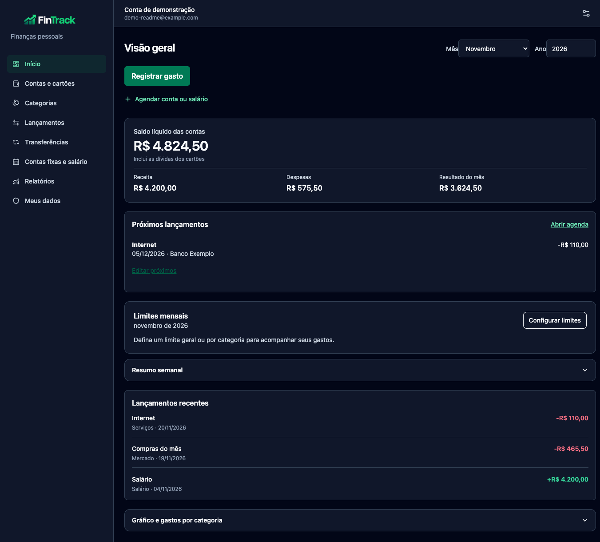

# FinTrack Web

Frontend de uma aplicação de gestão financeira pessoal, desenvolvido com **React e TypeScript**. A interface consome a [FinTrack API](https://github.com/Padokazzz/FinTrack), permitindo que usuários organizem contas, categorias e transações e acompanhem um resumo financeiro mensal.

O objetivo do projeto é construir uma experiência de uso completa em torno de uma API própria, com componentes reutilizáveis, formulários validados, gerenciamento de estado remoto e tratamento consistente dos estados da interface.



## Funcionalidades

- Cadastro e login com autenticação JWT.
- Dashboard com resumo financeiro mensal.
- Gerenciamento de contas e categorias.
- Criação, edição, consulta e remoção de transações.
- Criação, consulta e reversão de transferências entre contas.
- Filtros por mês, ano, tipo e categoria.
- Históricos de transações e transferências paginados pela API.
- Agenda de recorrências mensais e projeção de saldo por conta.
- Detalhamento de despesas e receitas por categoria, com exportação mensal em CSV.
- Formulários com validação.
- Estados de carregamento, erro e ausência de dados.
- Área autenticada com navegação lateral.

## Stack

| Responsabilidade | Tecnologias |
| --- | --- |
| Interface | React · TypeScript · Vite |
| Rotas | React Router |
| Estado remoto | TanStack Query |
| Formulários | React Hook Form · Zod |
| HTTP | Axios |
| Estilização | Tailwind CSS |
| Visualização de dados | Recharts |
| Ícones | Lucide React |
| Qualidade | ESLint |

## Organização do código

A estrutura é organizada por funcionalidades. Cada domínio mantém próximo o que pertence a ele, enquanto componentes e utilitários compartilhados ficam em diretórios próprios.

```text
src/
├── app/
│   ├── providers.tsx
│   └── routes.tsx
├── components/
│   ├── layout/
│   └── ui/
├── features/
│   ├── accounts/
│   ├── auth/
│   ├── categories/
│   ├── summaries/
│   ├── transactions/
│   └── transfers/
└── lib/
    ├── api.ts
    ├── api-error.ts
    ├── auth-storage.ts
    └── formatters.ts
```

### Decisões de implementação

- **Organização por domínio:** telas, serviços, tipos, schemas e componentes relacionados ficam agrupados por funcionalidade.
- **TanStack Query:** gerencia cache, carregamento, erros e atualização dos dados remotos.
- **React Hook Form + Zod:** combina gerenciamento de formulários e validação de dados.
- **Axios:** centraliza a comunicação HTTP com a API.
- **Componentes compartilhados:** elementos de interface e layout são reutilizados sem acoplar as funcionalidades entre si.

## Integração com o backend

Este frontend depende da [FinTrack API](https://github.com/Padokazzz/FinTrack).

A URL base padrão esperada é:

```text
http://localhost:8080/api
```

Se a API estiver em outro endereço, configure `VITE_API_BASE_URL` no ambiente do frontend.

## Executar localmente

### Pré-requisitos

- Node.js e npm.
- Git.
- FinTrack API em execução.

Clone o repositório:

```bash
git clone https://github.com/Padokazzz/fintrack-web.git
cd fintrack-web
```

Instale as dependências e configure o ambiente:

```bash
npm install
cp .env.example .env
```

No arquivo `.env`, informe a URL da API:

```env
VITE_API_BASE_URL=http://localhost:8080/api
```

Inicie o servidor de desenvolvimento:

```bash
npm run dev
```

A aplicação ficará disponível em `http://localhost:5173`.

Em outro terminal, inicie a API seguindo as instruções do [README do backend](https://github.com/Padokazzz/FinTrack).

## Scripts

| Comando | Descrição |
| --- | --- |
| `npm run dev` | Inicia o servidor de desenvolvimento. |
| `npm run build` | Gera a build de produção. |
| `npm test` | Executa testes de componentes e dos fluxos HTTP simulados. |
| `npm run lint` | Executa o ESLint. |
| `npm run preview` | Pré-visualiza a build localmente. |

O GitHub Actions roda a instalação pelo lockfile, o lint, os testes, o build e a montagem da imagem Docker em pull requests para a `main`. Para repetir as verificações localmente:

```bash
npm ci
npm run lint
npm test
npm run build
```

## Fluxo principal

1. O usuário cria uma conta ou realiza login.
2. A aplicação utiliza o token JWT nas chamadas autenticadas.
3. O usuário cadastra contas financeiras e categorias.
4. As transações são registradas e associadas aos recursos correspondentes.
5. O dashboard consulta os dados e apresenta o resumo do período.

## Executar com Docker

Com a API rodando na porta 8080, construa a imagem e publique o frontend na porta 3000.

```bash
docker build -t fintrack-web .
docker run --rm -p 3000:80 fintrack-web
```

A imagem usa Nginx para servir as rotas do React e encaminhar `/api` para `http://host.docker.internal:8080`. Use `-e FINTRACK_API_UPSTREAM=http://outro-host:8080` para ajustar o destino. Em Docker Engine no Linux, acrescente `--add-host=host.docker.internal:host-gateway` se usar o destino padrão.

## Recorrências

Em **Recorrências**, selecione **Nova recorrência**, vincule uma conta e uma categoria e informe a primeira data. Para salário ou débito fixo, escolha **Registrar automaticamente** e informe o valor. Para contas variáveis, escolha **Confirmar manualmente** e preencha o valor real quando a ocorrência aparecer na agenda.

O dashboard mostra os próximos lançamentos. A agenda mostra os saldos projetados até 30 dias e sinaliza contas com valores a definir. Você pode pausar, retomar ou excluir regras pela mesma tela.

## Tratamento de estados e validações

Os formulários utilizam Zod integrado ao React Hook Form para validar os dados antes do envio. A interface também contempla estados de carregamento, listas vazias e falhas nas operações.

Quando um JWT expira, o frontend tenta renovar a sessão por cookie HttpOnly e repetir a requisição uma vez. Se a renovação for recusada, o usuário volta ao login.

## Próximas melhorias

- [x] Adicionar testes de componentes.
- [x] Criar testes de integração para fluxos com a API.
- [x] Aplicar carregamento sob demanda nas rotas.
- [x] Evoluir a experiência em dispositivos móveis.
- [x] Ampliar os gráficos e filtros do dashboard.
- [x] Preparar imagem Docker para o frontend.

## Projeto relacionado

- [FinTrack API](https://github.com/Padokazzz/FinTrack): backend em ASP.NET Core e PostgreSQL.

---

Desenvolvido por [Leonardo Padilha](https://www.leonardopadilha.com).

## Desktop macOS com Tauri

O desktop reutiliza as telas do React e conecta à mesma API .NET usada pelo site.
Instale o Rust estável e as ferramentas de compilação do Xcode. Com a API e o
PostgreSQL rodando no Docker, execute:

```bash
npm ci
npm run desktop:dev
npm run desktop:build -- --bundles app
```

A API padrão é `http://127.0.0.1:8080`. Para compilar com outra origem, defina
`FINTRACK_DESKTOP_API_URL=https://api.example.com` antes do comando. A camada
nativa aceita HTTPS ou HTTP de loopback e mantém o cookie de renovação em
memória. Ao encerrar totalmente o app, é preciso entrar de novo. A exportação
CSV abre o diálogo de salvamento do sistema.

Para testar o transporte com a API e o PostgreSQL descartáveis:

```bash
cd src-tauri
cargo test
FINTRACK_DESKTOP_TEST_API_URL=http://127.0.0.1:8080 cargo test refresh_and_export_against_fintrack_api -- --ignored
```

A primeira validação tem como alvo o macOS. O app precisa alcançar a API para
consultar ou registrar dados. A conexão e o salvamento nativos ficam separados
das telas, que são compartilhadas com a versão web.

## Android e iOS

O app mobile usa Tauri 2, as mesmas telas React e a mesma API do site.
A exportação CSV está disponível no site e no desktop.

Para configurar o ambiente, siga os [pré-requisitos do Tauri](https://v2.tauri.app/start/prerequisites/).
O projeto Android usa SDK 36 e NDK. O iOS requer macOS, Xcode, CocoaPods e XcodeGen.

```bash
npm ci
npm run android:dev
npm run ios:dev
```

Sem configuração, o app mobile procura a API em `http://127.0.0.1:8080`.
Para um Android conectado ao computador, encaminhe a porta com `adb reverse tcp:8080 tcp:8080`.
O simulador iOS pode usar a API local do Mac. Para celulares fora desse ambiente,
defina `FINTRACK_MOBILE_API_URL` com a origem HTTPS da API antes de compilar, sem
o sufixo `/api`. Essa origem é definida no build nativo e vale para todas as requisições.

```bash
FINTRACK_MOBILE_API_URL=https://api.example.com npm run android:build -- --debug --apk
FINTRACK_MOBILE_API_URL=https://api.example.com npm run ios:build
```

O comando Android acima gera um APK de teste. Para distribuir, configure a
assinatura Android e gere um AAB com `npm run android:build -- --aab`.
Para um build iOS em aparelho físico ou distribuição, configure a equipe e o
provisionamento da Apple no Xcode.

## Instalar pelo navegador

Com o FinTrack publicado em HTTPS, é possível instalar o site pela opção **Instalar FinTrack** ou pelo menu do navegador.

- Android com Chrome: abra o menu e selecione **Instalar app** ou **Adicionar à tela inicial**.
- iPhone e iPad com Safari: abra **Compartilhar**, selecione **Adicionar à Tela de Início** e confirme. Ative **Abrir como App da Web** se essa opção aparecer.

O ícone abre a versão web do FinTrack. O acesso aos dados continua dependendo de conexão com a API.

### Sessão da versão web publicada

Sirva o site e `/api` na mesma origem HTTPS. A versão web restaura a sessão
usando o cookie de renovação da API e mantém o token de acesso em memória.
O Nginx aplica uma política de segurança de conteúdo que permite chamadas
à API da própria origem. Aplique os mesmos cabeçalhos se publicar com outro
servidor ou ingresso.
