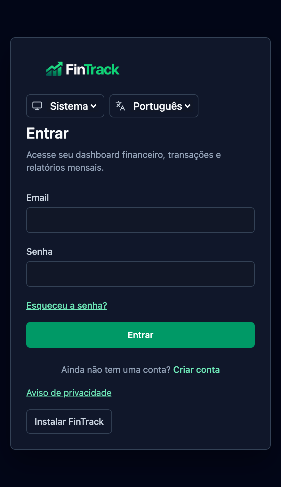
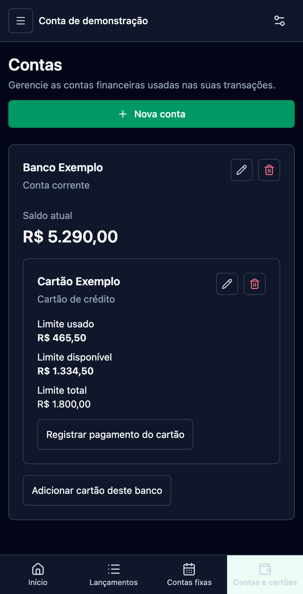

# FinTrack Web

Organize contas, cartões e despesas recorrentes, registre gastos e acompanhe seus limites no mesmo lugar. A versão web funciona no navegador e pode ser adicionada à tela inicial do celular.

[Abrir o FinTrack](https://fintrack.thecodefy.com/) · [Criar conta](https://fintrack.thecodefy.com/register) · [Recuperar senha](https://fintrack.thecodefy.com/forgot-password) · [Aviso de privacidade](https://fintrack.thecodefy.com/privacy) · [Repositório da API](https://github.com/Padokazzz/FinTrack)

## Interface

Capturas da versão atual com dados de demonstração.


| Login no celular | Contas e cartões no celular |
| --- | --- |
|  |  |

## Funcionalidades

- **Visão geral e lançamento rápido.** O painel reúne saldo, receitas, despesas, próximos pagamentos e limites mensais. Crie conta ou categoria no próprio formulário do primeiro gasto.
- **Contas e cartões.** Vincule um cartão ao banco, consulte limite usado e disponível e registre o pagamento pela conta vinculada. O pagamento entra como transferência, sem duplicar a despesa.
- **Contas fixas e salário.** Agende energia, água, internet, streaming, aluguel, salário, empréstimo ou financiamento. Escolha a forma de pagamento, a conta e uma data final opcional. Confirme parcelas pendentes no painel e edite as próximas sem alterar o histórico já gerado.
- **Amortizações.** Registre o valor pago, as parcelas finais abatidas ou ambos. Informe o total restante antes e depois para calcular a economia estimada por amortização e o acumulado da dívida.
- **Acompanhamento de gastos.** Defina limites gerais e por categoria, compare semanas e consulte relatórios mensais com exportação CSV.
- **Acesso e privacidade.** Confirme o e-mail, recupere a senha por código e acesse **Meus dados** para exportar ou excluir o cadastro.
- **Interface responsiva.** A navegação inferior dá acesso aos fluxos principais no celular. Tema, idioma e instalação ficam nas preferências.

## Stack

| Responsabilidade | Tecnologias |
| --- | --- |
| Interface | React · TypeScript · Vite |
| Rotas | React Router |
| Estado remoto | TanStack Query |
| Formulários | React Hook Form · Zod |
| HTTP | Axios |
| Estilização | Tailwind CSS |
| Visualização de dados | Recharts |
| Ícones | Lucide React |
| Qualidade | ESLint |

## Organização do código

A estrutura é organizada por funcionalidades. Cada domínio mantém próximo o que pertence a ele, enquanto componentes e utilitários compartilhados ficam em diretórios próprios.

```text
src/
├── app/
│   ├── providers.tsx
│   └── routes.tsx
├── components/
│   ├── layout/
│   └── ui/
├── features/
│   ├── accounts/
│   ├── auth/
│   ├── categories/
│   ├── privacy/
│   ├── recurrences/
│   ├── summaries/
│   ├── transactions/
│   └── transfers/
└── lib/
    ├── api.ts
    ├── api-error.ts
    ├── auth-storage.ts
    └── formatters.ts
```

### Decisões de implementação

- **Organização por domínio:** telas, serviços, tipos, schemas e componentes relacionados ficam agrupados por funcionalidade.
- **TanStack Query:** gerencia cache, carregamento, erros e atualização dos dados remotos.
- **React Hook Form + Zod:** combina gerenciamento de formulários e validação de dados.
- **Axios:** centraliza a comunicação HTTP com a API.
- **Componentes compartilhados:** elementos de interface e layout são reutilizados sem acoplar as funcionalidades entre si.

## Integração com o backend

Este frontend depende da [FinTrack API](https://github.com/Padokazzz/FinTrack).

A URL base padrão esperada é:

```text
http://localhost:8080/api
```

Se a API estiver em outro endereço, configure `VITE_API_BASE_URL` no ambiente do frontend.

## Executar localmente

### Pré-requisitos

- Node.js e npm.
- Git.
- FinTrack API em execução.

Clone o repositório:

```bash
git clone https://github.com/Padokazzz/fintrack-web.git
cd fintrack-web
```

Instale as dependências e configure o ambiente:

```bash
npm ci
cp .env.example .env
```

No arquivo `.env`, informe a URL da API:

```env
VITE_API_BASE_URL=http://localhost:8080/api
```

Inicie o servidor de desenvolvimento:

```bash
npm run dev
```

A aplicação ficará disponível em `http://localhost:5173`.

Em outro terminal, inicie a API seguindo as instruções do [README do backend](https://github.com/Padokazzz/FinTrack).

## Scripts

| Comando | Descrição |
| --- | --- |
| `npm run dev` | Inicia o servidor de desenvolvimento. |
| `npm run build` | Gera a build de produção. |
| `npm test` | Executa testes de componentes e dos fluxos HTTP simulados. |
| `npm run lint` | Executa o ESLint. |
| `npm run preview` | Pré-visualiza a build localmente. |

O GitHub Actions roda a instalação pelo lockfile, o lint, os testes, o build e a montagem da imagem Docker em pull requests para a `main`. Para repetir as verificações localmente:

```bash
npm ci
npm run lint
npm test
npm run build
```

## Primeiros lançamentos

1. Entre na sua conta e selecione **Registrar gasto** na visão geral.
2. Informe o valor, escolha a conta ou cartão e selecione a categoria. Se necessário, crie a conta ou categoria ali mesmo.
3. Em **Limites mensais**, defina quanto deseja gastar no total ou por categoria.

## Executar com Docker

Com a API rodando na porta 8080, construa a imagem e publique o frontend na porta 3000.

```bash
docker build -t fintrack-web .
docker run --rm -p 3000:80 fintrack-web
```

A imagem usa Nginx para servir as rotas do React e encaminhar `/api` para `http://host.docker.internal:8080`. Use `-e FINTRACK_API_UPSTREAM=http://outro-host:8080` para ajustar o destino. Em Docker Engine no Linux, acrescente `--add-host=host.docker.internal:host-gateway` se usar o destino padrão.

## Contas fixas e amortizações

Em **Contas fixas e salário → Novo agendamento**, escolha um modelo, informe a primeira data e selecione a conta ou o cartão. A **forma de pagamento** indica como o dinheiro sai. A opção **Como registrar?** define se o FinTrack lança o valor na data ou espera sua confirmação. Para débito automático, escolha uma conta bancária. O pagamento em si é feito pelo banco ou pelo meio escolhido.

Para uma dívida parcelada, informe a data da última parcela. Em **Amortizações**, você pode abater parcelas finais e salvar os dados do cálculo de economia. Se já quitou a dívida, informe zero como total restante depois. A saída de dinheiro fica em **Lançamentos**.

## Tratamento de estados e validações

Os formulários utilizam Zod integrado ao React Hook Form para validar os dados antes do envio. A interface também contempla estados de carregamento, listas vazias e falhas nas operações.

Quando um JWT expira, o frontend tenta renovar a sessão por cookie HttpOnly e repetir a requisição uma vez. Se a renovação for recusada, o usuário volta ao login.

## Desktop macOS com Tauri

O desktop reutiliza as telas do React e conecta à mesma API .NET usada pelo site.
Instale o Rust estável e as ferramentas de compilação do Xcode. Com a API e o
PostgreSQL rodando no Docker, execute:

```bash
npm ci
npm run desktop:dev
npm run desktop:build -- --bundles app
```

A API padrão é `http://127.0.0.1:8080`. Para compilar com outra origem, defina
`FINTRACK_DESKTOP_API_URL=https://api.example.com` antes do comando. A camada
nativa aceita HTTPS ou HTTP de loopback e mantém o cookie de renovação em
memória. Ao encerrar totalmente o app, é preciso entrar de novo. A exportação
CSV abre o diálogo de salvamento do sistema.

Para testar o transporte com a API e o PostgreSQL descartáveis:

```bash
cd src-tauri
cargo test
FINTRACK_DESKTOP_TEST_API_URL=http://127.0.0.1:8080 cargo test refresh_and_export_against_fintrack_api -- --ignored
```

A primeira validação tem como alvo o macOS. O app precisa alcançar a API para
consultar ou registrar dados. A conexão e o salvamento nativos ficam separados
das telas, que são compartilhadas com a versão web.

## Android e iOS

O app mobile usa Tauri 2, as mesmas telas React e a mesma API do site.
A exportação CSV está disponível no site e no desktop.

Para configurar o ambiente, siga os [pré-requisitos do Tauri](https://v2.tauri.app/start/prerequisites/).
O projeto Android usa SDK 36 e NDK. O iOS requer macOS, Xcode, CocoaPods e XcodeGen.

```bash
npm ci
npm run android:dev
npm run ios:dev
```

Sem configuração, o app mobile procura a API em `http://127.0.0.1:8080`.
Para um Android conectado ao computador, encaminhe a porta com `adb reverse tcp:8080 tcp:8080`.
O simulador iOS pode usar a API local do Mac. Para celulares fora desse ambiente,
defina `FINTRACK_MOBILE_API_URL` com a origem HTTPS da API antes de compilar, sem
o sufixo `/api`. Essa origem é definida no build nativo e vale para todas as requisições.

```bash
FINTRACK_MOBILE_API_URL=https://api.example.com npm run android:build -- --debug --apk
FINTRACK_MOBILE_API_URL=https://api.example.com npm run ios:build
```

O comando Android acima gera um APK de teste. Para distribuir, configure a
assinatura Android e gere um AAB com `npm run android:build -- --aab`.
Para um build iOS em aparelho físico ou distribuição, configure a equipe e o
provisionamento da Apple no Xcode.

## Instalar pelo navegador

Abra a [versão publicada](https://fintrack.thecodefy.com/). Use **Preferências → Instalar FinTrack** quando a opção estiver disponível, ou instale pelo próprio navegador.

- Android com Chrome: abra o menu e selecione **Instalar app** ou **Adicionar à tela inicial**.
- iPhone e iPad com Safari: abra **Compartilhar**, selecione **Adicionar à Tela de Início** e confirme. Ative **Abrir como App da Web** se essa opção aparecer.

O ícone abre a versão web do FinTrack. O acesso aos dados continua dependendo de conexão com a API.

### Sessão da versão web publicada

Sirva o site e `/api` na mesma origem HTTPS. A versão web restaura a sessão
usando o cookie de renovação da API e mantém o token de acesso em memória.
O Nginx aplica uma política de segurança de conteúdo que permite chamadas
à API da própria origem. Aplique os mesmos cabeçalhos se publicar com outro
servidor ou ingresso.

### Privacidade

O [aviso de privacidade](https://fintrack.thecodefy.com/privacy) é público. **Meus dados** fica no menu após o login
e exige a senha atual para exportar ou excluir o cadastro.

Antes de disponibilizar o FinTrack a pessoas com dados reais, configure
`VITE_PRIVACY_CONTROLLER` (nome do responsável) e `VITE_PRIVACY_CONTACT`
(e-mail que recebe solicitações). Em Docker, use esses valores como
argumentos do build. Revise o aviso com as bases legais por finalidade,
os fornecedores e compartilhamentos efetivos e os prazos de retenção.
Teste o canal para identificação e atendimento de pedidos de correção,
acesso e exclusão. Defina também o tratamento de cópias de segurança e logs
com os provedores escolhidos para o piloto.

---

Desenvolvido por [Leonardo Padilha](https://www.leonardopadilha.com).
